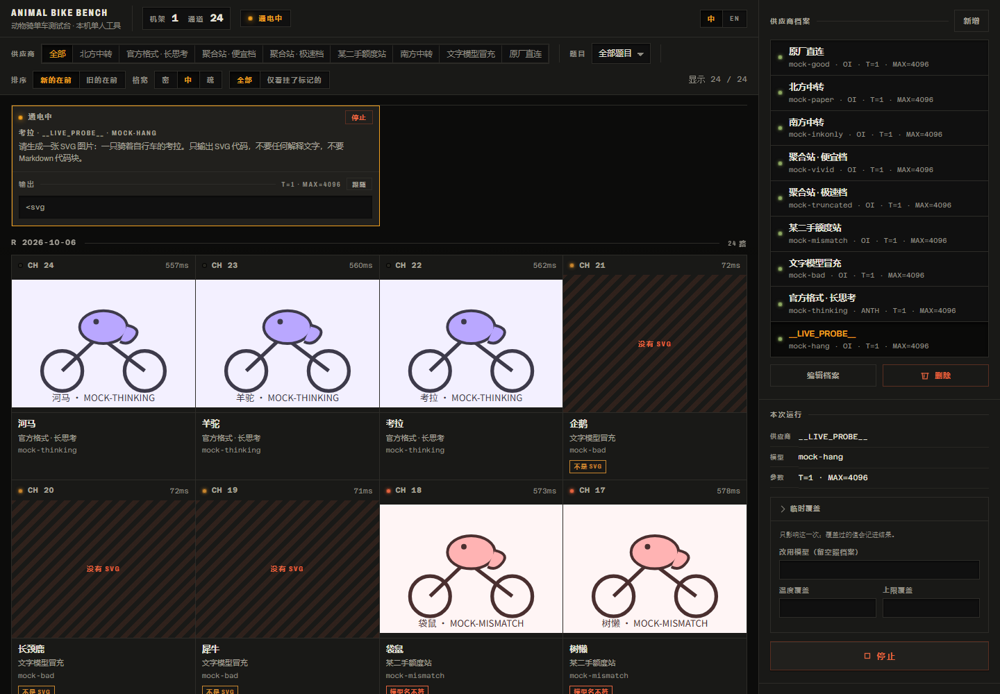
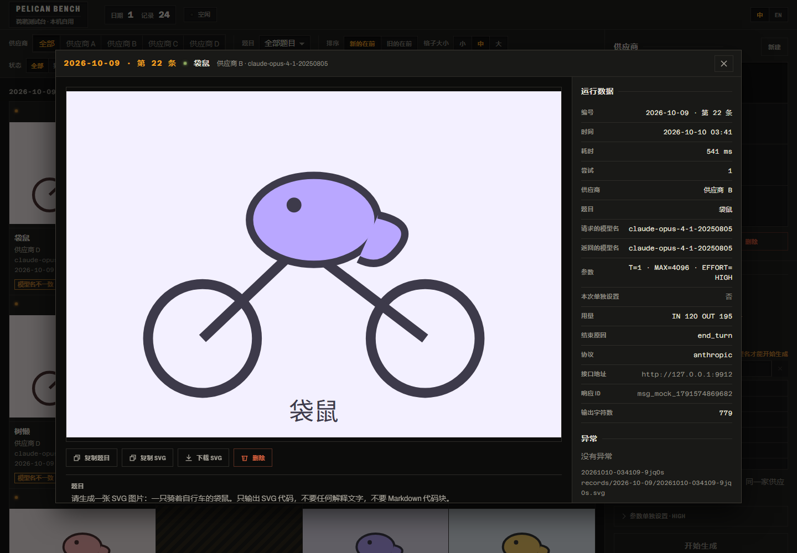
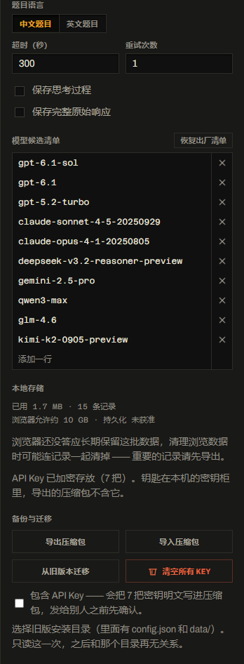
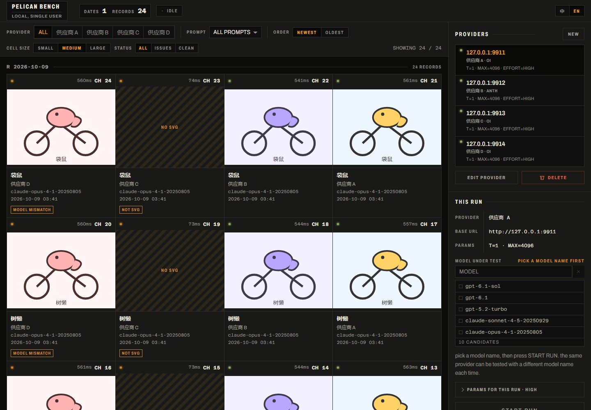

# 鹈鹕测试台 · Pelican Bench

[](LICENSE)
[](#它不做什么)
[](#支持的协议)

**同一个 `claude-sonnet-4-5`，在 A 家画出一只像样的鹈鹕，在 B 家只回一句「我画不了」，在 C 家画得挺好、但响应体里回显的是另一个模型名。**

这个工具把这些事看见，并留下证据。

每次运行随机抽一道题，让模型输出一张「骑着自行车的某动物」的 SVG。不评分、不排名 ——
结果按时间沉淀成一本标本册，判断留给人的眼睛。



*一次运行 = 一条记录。左边是作品墙，右边是供应商档案与本次运行设置。*

---

| | |
| --- | --- |
| **要回答的问题** | 同一个模型名，换个供应商，还画得出来吗 |
| **怎么回答** | 一题一图，原样留存，只贴可复现的事实标签 |
| **不做什么** | 不打分、不排名、不请 LLM 当裁判、不并发跑分、不上云 |
| **技术栈** | React 18 + Vite + TypeScript —— **没有后端**，整个产物是一堆静态文件 |
| **数据存在哪** | 浏览器本地（IndexedDB），可用一个 `.zip` 整体导出/导入 |
| **界面语言** | 中文 / English |

## 它不做什么

边界决定了这个工具长什么样：

| 不做 | 因为 |
| --- | --- |
| 打分、排名、LLM 当裁判 | 任何看起来像分数或胜负的视觉语言都是越界 |
| 批量并发跑分 | 一次一道题、一家供应商；横向对比靠事后翻画廊 |
| 账号、多用户、多设备同步 | 永远只服务一台机器上的一个人 |
| 替模型补台面 | 背景由模型自己的 SVG 决定，工具不统一底色 |
| 服务端保存任何东西 | 没有服务端。没有服务器经手过你的 Key 和画 |

它不是评测平台，是一张工作台加一本标本册。

## 快速开始

需要 Node.js 20 或更高版本（只用来开发和构建，运行时不需要它）。

```bash
npm install
npm run dev
```

打开 http://127.0.0.1:5174 ，在右栏新增供应商（协议 + 接口地址 + 密钥），**再选一个模型名**，
点「开始生成」。

构建出一份可以随便丢的静态产物：

```bash
npm run build      # → dist/web/（index.html 引用的资源全是相对路径）
npm run preview    # 本地起个静态服务器看构建产物
```

## 怎么部署

`dist/web/` 就是全部 —— 没有 Node、没有 API 路由、没有要配的环境变量。

| 放法 | 说明 |
| --- | --- |
| 双击 `dist/web/index.html` | Chromium 下可用。`file://` 里 IndexedDB 是通的，直接就能跑起来 |
| 任意静态托管 | Vercel / Netlify / GitHub Pages / 内网目录都行，子路径也认（产物是相对路径） |
| Vercel | 仓库里带了 `vercel.json`（构建命令与输出目录已配好） |

> [!IMPORTANT]
> **只承诺 Chromium 内核（Chrome / Edge）。** Firefox 与 Safari 没测过：这些浏览器对
> `file://` 下的 IndexedDB、以及对流式响应体的处理都不一样。

## 换了几台机器？先导出

数据在浏览器里，所以**清一次浏览器数据就等于删库**。这不是隐喻：

| 会发生什么 | 结果 |
| --- | --- |
| 「清除浏览数据」勾了「Cookie 及其他站点数据」 | 记录、设置、API Key 全没 |
| 换一个浏览器 | 数据不跟着走（Chrome 一份，Edge 一份） |
| 换一个 Windows 用户 / 换台电脑 | 没有 |
| 用无痕窗口 | 关掉窗口就没 |

所以日常动作是**导出**：右下角「导出压缩包」产出一个 `.zip`，内部结构与旧版安装目录**逐字一致**：

```
config.json                         设置
prompts.json                        题池
config.local.json                   API Key —— 只有勾了「包含 API Key」才会写进去
data/records/2026-10-06/
  20261006-211451-8x5hr.json        元数据 + 标签
  20261006-211451-8x5hr.svg         抽出来的 SVG
  20261006-211451-8x5hr.raw.txt     完整原始响应（按开关）
  20261006-211451-8x5hr.reasoning.txt  思考过程（按开关）
```

同一个 zip 再「导入压缩包」就能还原。导入的语义是**只补空、不覆盖已有记录**：设置与题池
只在本地还没有的时候整份写入，供应商档案按 id 并进来，记录按 id 更新、绝不删除已有的那批。

> [!TIP]
> **从旧版本（带 exe 的那个）搬过来**：点「从旧版本迁移」，选中旧安装目录 —— 源码版是项目根
> 目录，exe 版是 `%APPDATA%\PelicanBench`。它会读 `config.json` / `prompts.json` /
> `config.local.json` / `data/records/`，一次性搬进浏览器。
>
> 旧版把供应商档案弄丢过（`providers` 是空数组、密钥还在）也能救回来：迁移时会**从记录里
> 反推出档案**（记录里存了 `providerName` / `protocol` / `baseUrl`）。只有那些「既没档案、
> 也没跑过一次」的密钥才会变成「待认领的 Key N」，等你补一个地址。

## API Key 存在哪

在浏览器的 IndexedDB 里，**加密存放**。界面上一律打码显示，右上角有「清空所有 Key」（按两下
才生效，六秒后自动弹回）。

加密用浏览器自带的 WebCrypto：第一次要存 Key 时生成一把 AES-GCM-256 的**密钥柜钥匙**，它自己
以「不可导出」的形式躺在库里（`meta` 表的 `vault-key` 那一行）—— 连程序自身都读不出那 32 个
字节，只能拿它去解密。每把 Key 各配一段随机 iv，密文与供应商 id 绑定，所以把一家的密文贴到
另一家身上是解不开的。旧版留下的明文行，读到的那一刻就会被加密写回。

> [!WARNING]
> **这挡的是「翻」，不是「拿」。** 挡住的是：翻 DevTools → IndexedDB 看见一把把 `sk-...`、
> 按 `sk-` 扫一遍硬盘、把库 dump 出来当 JSON 看。**挡不住**：同源页面（用 `file://` 打开时，
> 整台机器上所有本地 html 都算同一个源）、整份浏览器 profile 被拷走、装在你浏览器里的扩展、
> 以及已经坐在你解锁的电脑前的人 —— 钥匙柜和密文在同一台机器上，能打开这个页面的人就能用它
> 去请求 API。
>
> **导出勾「包含 API Key」时写出去的仍然是明文**（`config.local.json`，为了让旧版 exe 还能读）。
> 所以那个框默认不勾；勾之前先想一下这个 zip 要发去哪儿。
>
> 实际做法：给这个工具一个专用浏览器（或专用 profile），定期导出备份；不用的 Key 直接在
> 供应商那边吊销。

浏览器没有 WebCrypto（很老的版本）时会自动退回明文存放，并在「本地存储」那里明说 —— 宁可说
清楚，也不假装加了密。库被搬去别的电脑、或者钥匙换过时，会有一批 Key 解不开：界面报「有 N 把
Key 解不开，请重新填一次」，那几行保留不动（删了就真没救了）。

## 支持的协议

只有两种。

| 协议 | 端点 | 鉴权头 |
| --- | --- | --- |
| `openai`（[OI] 兼容） | `POST {baseUrl}/v1/chat/completions` | `Authorization: Bearer <key>` |
| `anthropic`（Messages） | `POST {baseUrl}/v1/messages` | `x-api-key: <key>` + `anthropic-version: 2023-06-01` |

`baseUrl` 填到根即可（如 `https://api.example.com`），路径由程序拼。地址必须以
`http://` 或 `https://` 开头，少写了「测试连接」会当场告诉你，不会憋着不发请求。

### 只能连 CORS 友好的站

浏览器直连别人的 API，这里的规则由对方（和浏览器）定，不由我们：

| 站点 | 能不能用 |
| --- | --- |
| 中转站 / 自建代理站（通常是这两样） | 能用 —— 实测 `api.a6api.com`、`api.banban.plus` 预检与流式都通 |
| 官方 `api.openai.com` | **不能**，预检就被拒（加 `anthropic-dangerous-direct-browser-access` 也一样） |
| 官方 `api.anthropic.com` | **不能**，同上 |
| 局域网自建（Ollama、one-api 等） | 一般能用，需要它允许跨源 |

所以「测试连接」失败时，工具会补一次探测，把两种完全不同的原因分开说：

- **「能连上，但没有返回浏览器需要的 CORS 允许头」** —— 服务器活着，是跨源策略挡住了你。
- **「连不上 host（域名解析失败 / 端口不通 / 网络被阻断）」** —— 根本没连上。

> [!NOTE]
> 「经本站代理」这个开关是给官方站留的一条路：勾上之后请求走同源的 `/api-proxy/openai`
> 或 `/api-proxy/anthropic`，由**部署这个页面的主机**转发给上游（`vercel.json` 里配好了
> 那两条 rewrite）。它只在有后端能力的主机上有效；直接打开本地 html 时这个开关没有意义。
> 另外，Vercel 的 rewrite 会不会把 SSE 流缓冲成一坨，**没有实测过**。

## 用法

### 供应商档案里没有「模型名」这一栏

添加供应商只填名称、协议、接口地址、密钥、默认参数。模型名是**每次运行现场选的必填项**。

> [!IMPORTANT]
> 这是刻意的。工具唯一要回答的问题是「**同一个模型名**在不同供应商名下表现如何」，
> 把模型名存进档案，等于让每家自带一个被测量，横向对比当场失效。

### 参数的三个层次

`全局默认 → 供应商覆盖 → 本次运行覆盖`，后者压前者。

`max_tokens` 全局默认 **32000**，是当作「放开思考」用的，不是算出来的数 —— [OI] 兼容协议里
这**一个**数同时管思考链和正文，8192 会在模型还在想的时候就把额度用光。

> [!NOTE]
> 供应商那层**留空即跟随全局默认**。别每家抄一遍，否则改全局不会生效。

### 思考强度

六档 `minimal / low / medium / high / xhigh / max`，默认 `high`，按协议换算：

- `openai` —— 原样发 `reasoning_effort`。实测上游会校验这个字段，编造的值稳定返回 400。
- `anthropic` —— 换算成 `thinking.budget_tokens`（1024 / 2048 / 4096 / 8192 / 12288 / 16000，
  1024 是官方硬下限），并把 temperature 强制成 1，代价是 `top_p` 永远不会被发出去。

> [!WARNING]
> Anthropic 那张换算表**没有实测过**（手上没有 Anthropic 的 key）。`openai` 那张是实测的。

档位在真实负载上分得开，但幅度温和：实测同一道题 `minimal → max`，思考字符 **+61%**、
总输出 token **+45%**、耗时 **+39%**。

## 标签

判定不靠 LLM 裁判，全是可复现的事实。**只要挂了任何一个标签，`ok` 就是 false** ——
换模型、截断正是要抓的降智信号，不能让它们显示成正常。



*每条记录都有这样一页读数：请求的模型名与返回的模型名并排摆着，「异常」一栏要么空着，要么列出挂上的标签。*

| 标签 | 含义 |
| --- | --- |
| `not-svg` | 输出里根本没有可用的 SVG（典型：模型说「我画不了」） |
| `truncated` | SVG 没闭合，或 `finish_reason` 是 `length` / `max_tokens` |
| `model-mismatch` | 响应体里的 `model` 与请求不一致 —— **最值得警惕的偷换模型信号** |
| `render-failed` | 抽出来的 SVG 解析不过，浏览器渲染不出来 |
| `http-error` | 上游返回错误状态码 |
| `timeout` | 超过设定的超时秒数 |
| `aborted` | 手动点了停止 |

大小写差异（请求 `Claude-Sonnet-4-5` 返回 `claude-sonnet-4-5`）不算不符，不会误报。

告警只有两档，同一套语义贯穿画面、指示灯、异常标签三处：

- **红灯** —— 请求根本没拿到东西：`http-error`、`timeout`、`render-failed`。
- **琥珀灯** —— 拿到了但有毛病：`not-svg`、`truncated`、`model-mismatch`、`aborted`。
- **橄榄绿灯** —— 干净跑完，一个标签都没有。**熄灭**只出现在「这一格还没跑过」的时候。

红留给「请求压根没通」，其余一律降一档，**不让告警盖过画本身**。

## 运行行为

- 超时默认 **300 秒**，按次算；超时算失败，计入重试。
- 重试默认 **1 次**（最多尝试 2 次），失败后按 0.5s / 1s / 2s… 退避，上限 4 秒。
- **无论成功、失败还是中止，都会落一条记录。** 中止时保存已收到的部分并打 `aborted`，
  不会白跑一趟。运行中实时显示代码与思考过程，结束后渲染最终 SVG。

> [!NOTE]
> 300 秒是按实测定的：一次 `high` effort 能跑到 **146 秒**（正文 12k 字符），
> 高 `effort` 下还会更长；早先的 120 秒很容易出现「模型明明画出来了，却被自己的超时掐掉」。
> 嫌等太久可以自己调小，改了要**点一下别处**才提交（那个格子是失焦存盘）。

## 数据落在哪

浏览器本地一个叫 `pelican-bench` 的 IndexedDB 库，五个表：

```
config      设置（含供应商档案；不含密钥）
keys        API Key 的密文（AES-GCM，每把一段随机 iv）
meta        密钥柜（不可导出的 CryptoKey）—— 导出与导入都不碰它
records     运行记录（元数据 + 标签）
sidecars    SVG / 原始响应 / 思考过程
```

题池是设置的一部分，界面上改，随时生效。题池的形状与旧版一致：

```json
{
  "animals": ["鹈鹕", "水豚", "鸭嘴兽"],
  "template": "请生成一张 SVG 图片：一只骑着自行车的{animal}。只输出 SVG 代码，不要任何解释文字，不要 Markdown 代码块。",
  "templateEn": "Generate an SVG image of a {animal} riding a bicycle. ...",
  "extras": [
    { "id": "bicycle-only", "label": "一辆自行车（无动物）", "text": "请生成一张 SVG 图片：一辆自行车。..." }
  ]
}
```

`{animal}` 是占位符，`animals` 里加一个名字就多一道题（出厂 20 只），`extras` 放不成组的散题。
题目语言在右栏切（`promptLang`）。想每次都画同一只动物，把 `animals` 临时改成只有一项即可。

右下角那块「本地存储」会报当前用量、记录条数、以及浏览器给不给持久化权限（`navigator.storage.persist()`）。
**没给也没关系** —— 记录照样在，只是浏览器在磁盘吃紧时更有权把它清掉。真正的备份手段永远是导出那个 zip。



那块里的「API Key 已加密存放（N 把）」就是密钥柜的状态：换一台没有 WebCrypto 的浏览器，这句话会变成
「是明文存放的」；库从别的电脑搬来、或者钥匙换过时，会补一行「有 N 把解不开」。

**渲染安全** —— 模型输出当不可信内容处理。落盘的原始 SVG 原样保留；所有真正拿去渲染的地方
先过 `sanitizeSvg`（去掉 `<script>` / `<foreignObject>` / `on*` 事件属性 / 非 `#` 开头的外链
`href` / `javascript:`）。缩略图走 ``（加载 SVG 不执行脚本），详情大图走 `sandbox=""`
且不给 `allow-scripts` 的 iframe，外加一层内联 CSP。整个 SVG 渲染面不允许任何外部请求。

## 项目结构

```
.
├─ web/                    React + Vite 前端（这里就是全部程序）
│  ├─ index.html           入口
│  ├─ vite.config.ts       base './' + 两条 /api-proxy rewrite（本地版）
│  ├─ vitest.config.ts     测试配置（root 指向 web/，否则找不到用例）
│  └─ src/
│     ├─ App.tsx           顶栏 + 筛选 + 画廊 + 右栏
│     ├─ api.ts            界面唯一碰数据的地方：档案 / 记录 / 导出导入 / 迁移 / 测连接
│     ├─ i18n.ts           中英文案（文案必须走 key，禁止硬编码）
│     ├─ components/       ControlPanel / Rack / SpecimenSheet / LiveBay / BusBar …
│     ├─ lib/
│     │  ├─ idb.ts             IndexedDB 打开与读写
│     │  ├─ config.ts          设置、题池、API Key
│     │  ├─ keyvault.ts        密钥柜：不可导出的 CryptoKey + AES-GCM 加解密
│     │  ├─ records.ts         记录与侧车（含通道号分配）
│     │  ├─ runner.ts          一次运行：抽题 → 请求 → 判定 → 落库（含重试与中止）
│     │  ├─ zipcodec.ts        导出 / 导入 / 从旧版迁移，共用一套编解码
│     │  ├─ net.ts             CORS 分因诊断 + 代理路由
│     │  └─ chat/              协议适配层：openai.ts / anthropic.ts / types.ts
│     └─ test/real-run.test.ts 真 Key 冒烟（默认跳过，要花钱）
├─ shared/                 前端与测试共享（这个项目里没有「后端」这一侧了）
│  ├─ types.ts             RunRecord · AppConfig · FlagCode · RunEvent · 出厂默认值
│  ├─ svg.ts               extractSvg / sanitizeSvg：抽取与渲染前的清洗
│  └─ prompts.ts           题池组装与抽题（注入 pool，不读文件）
├─ vercel.json             Vercel 的构建命令、输出目录与两条代理 rewrite
├─ dist/web/               构建产物（已 gitignore）
├─ docs/                   README 用的界面截图
└─ assets/                 图标源文件与生成脚本
```

## 开发

```bash
npm run typecheck    # tsc --noEmit
npm test             # vitest：106 个用例（编解码、存储、密钥柜、SVG 清洗、CORS 分因、api 层）
npm run build        # 产出 dist/web
```

`npm test` 里有两条**依赖本机数据**的用例：`web/src/lib/migrate-legacy-data.test.ts` 会拿
仓库里的旧安装目录（`config.json` / `data/records/`）当夹具 —— 没有那份数据时自动跳过，
不会装成失败。

想验证真 Key 走通的整条链路（会真的花一次钱，约 1～3 分钟）：

```bash
PB_REAL_RUN=1 npm test -- src/test/real-run.test.ts
```

它读仓库根的 `config.local.json` 取密钥，跑一次 `gpt-6.1-sol`，把增量块数、正文长度、用量、
标签打出来。默认目标是 `p_d34xbpav`（banban-0.18），换一家用 `PB_REAL_PROVIDER=<id>`。

## 已知限制

**随机抽题 + 不重跑同题，意味着各家画的是不同的动物。** 单次结果的差异不能直接归因于供应商，
要得出可信结论只能靠长期累积 —— 画企鹅比画章鱼难看，是题目难度问题，不是模型降智。

**数据在浏览器里，所以「这个工具的数据库」和「你正在用的这个浏览器」是一回事。** 换浏览器、
清站点数据、无痕窗口都会让它看起来像「数据丢了」。真正在用的数据请定期导出成 zip。

**只能连 CORS 友好的站。** 官方 OpenAI / Anthropic 的 API 在浏览器里直连是被对方拒绝的
（不是这个工具没做），所以这个工具实际服务的是「中转站横向比较」这件事。

> [!WARNING]
> **深色背景会吃掉一部分画。** 背景由模型的 SVG 自己决定，工具不替它补台面。所以一只用深色
> 描边、又没画底色的动物，在深色记录区里几乎看不见 —— 而它**不会**被标记成异常，因为它确实
> 画出了合法的 SVG。这是「原样留存优先于整洁」的代价：真要看清楚，打开详情页（那里同样是它
> 自己的背景），或者看 SVG 源码。界面上会明确指出这是「没画背景」，而不是含糊过去。

**原样留存优先于整洁。** 哪怕回来的是废话、半截标签、别人的模型名，也原封不动留着 ——
被清洗过的证据没有举证价值。清洗只作用于「渲染给人看」的那一层，源码层永远可回溯。

不做账号、不多用户、不云同步，就是个本机自用的工具。

## 从 0.1 走过来

0.1 是一个 Node + Express 的后端加一个 **93.9 MB 的单文件 exe**（其中 88 MB 是 node.exe 本身）。
0.2 把后端整个删掉，改成数据存在浏览器里：产物从 93.9 MB 变成**约 290 KB 的静态文件**，
不再需要运行时，部署不再需要服务器，代价是数据跟着浏览器走 —— 所以导出那个 zip 变成了
最重要的一个按钮。

## English

**Pelican Bench** is a local-only workbench for the one question provider shopping actually
raises: *is this provider serving me the model it claims to?*

It is **a pure static frontend** — no backend, no server, nothing to install. Your records live in
the browser's IndexedDB, API keys are stored there **AES-GCM encrypted** under a non-extractable
vault key, and one `.zip` moves the whole thing.



You register a provider (base URL + key — deliberately **no model name**), then pick a model name
per run. Each run draws one random prompt asking the model to output an SVG of some animal riding
a bicycle. Raw output is stored verbatim and shown in a gallery, tagged with reproducible, factual
flags:

`not-svg` · `truncated` · `model-mismatch` (the strongest substitution signal) · `render-failed` ·
`http-error` · `timeout` · `aborted`

There is no scoring, no LLM judge, no leaderboard, no accounts, no cloud. Two protocols only
(OpenAI-compatible `/v1/chat/completions` and Anthropic `/v1/messages`). Because prompts are random
and never re-run, **a single pair of images is not a fair comparison** — only accumulated samples
are. Bilingual UI, dark theme, keyboard-navigable, WCAG AA body contrast.

Requires Node.js 20+ **for development only**. `npm install && npm run dev`, then open
http://127.0.0.1:5174. `npm run build` emits `dist/web/` — a plain static site you can host
anywhere (or just open `index.html` in Chromium).

**Two things to know before you rely on it.** First, browsers only reach CORS-friendly endpoints,
so the official `api.openai.com` / `api.anthropic.com` are unreachable by design — relays and
self-hosted gateways work. Second, your data lives in one browser: switching browsers or clearing
site data looks exactly like losing everything, so export the `.zip` regularly. API keys are
encrypted at rest (AES-GCM under a non-extractable vault key), which hides them from disk scans and
DevTools — but not from a script on the same origin, which is *every* local html file when you open
this over `file://`. Exporting with "include API keys" ticked writes them in plain text, because the
old exe still has to read that file.

## License

[MIT](LICENSE)
